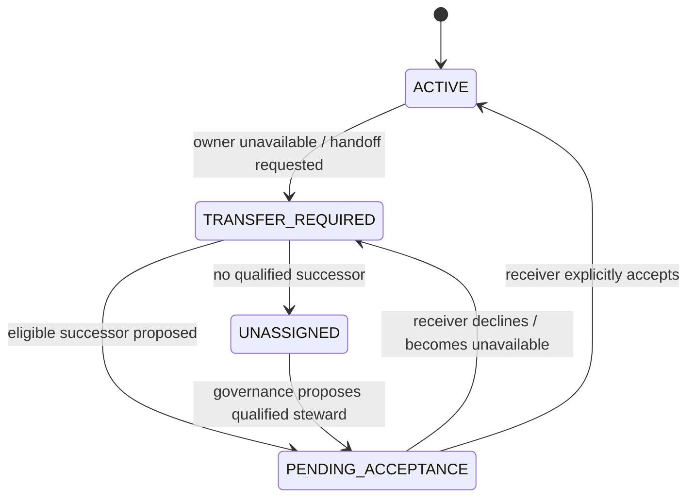

# ARK — human and team stewardship

## Why this module exists

A capable model deployment must always have an accountable human or team steward.
The steward is responsible for the deployment's approved purpose, evaluation,
monitoring, incident response, and escalation. This is operational responsibility,
not ownership of a model's identity, an unrestricted control right, or permission
to bypass safeguards.

## Transfer lifecycle



1. A governance operator marks a steward unavailable, or the current steward
   requests a handoff.
2. ARK restricts privileged actions while responsibility is unresolved.
3. A successor is selected only if active, available, qualified for the model's
   declared capabilities, and below its model capacity.
4. The receiving person/team must explicitly accept. The system never silently
   transfers responsibility.
5. If nobody qualifies, the deployment becomes **UNASSIGNED** and stays restricted.
   A later assignment also requires explicit acceptance.
6. Every state transition is recorded in a hash-chained audit history.

## Quick example

```python
from ark.governance.ownership import (
    OwnershipRegistry,
    Steward,
    StewardKind,
)

registry = OwnershipRegistry(governance_operators={"ops-admin"})
registry.register_steward(
    Steward("alice", StewardKind.PERSON, frozenset({"evaluate", "monitor"})),
    now=0,
)
registry.register_steward(
    Steward("safety-team", StewardKind.TEAM, frozenset({"evaluate", "monitor"})),
    now=0,
)
registry.register_model(
    "deployment-1",
    current_steward_id="alice",
    required_capabilities={"evaluate", "monitor"},
    now=1,
)

request = registry.request_transfer(
    "deployment-1",
    "safety-team",
    requested_by="alice",
    reason="planned operational handoff",
    now=2,
)
# Still restricted; the transfer is not complete yet.
assert not registry.privileged_actions_allowed("deployment-1")

registry.accept_transfer(
    request.transfer_id,
    actor_id="safety-team",
    now=3,
)
assert registry.privileged_actions_allowed("deployment-1")
```

## Security and research boundaries

- Steward IDs are **identifiers**, not authentication. Production use requires a
  trusted identity provider, role/permission service, and verified team membership.
- This prototype is in-memory. Production use requires transactional durable
  storage, concurrency control, backup/restore, and independently protected logs.
- The local hash chain detects accidental or unauthorized edits only when its
  trusted checkpoint is stored elsewhere. It is not a tamper-proof ledger.
- `privileged_actions_allowed()` is a governance decision helper, not an
  enforcement boundary. A separate trusted control plane must enforce it on
  every tool and actuator request.
- Human acceptance is mandatory; no model can accept responsibility for itself.
- Transfer does not erase the previous steward's audit history or transfer
  credentials, secrets, or personal data.
- No software mechanism proves zero risk or guarantees that an AI system can
  never behave unexpectedly.

## Tests

```bash
pytest -q tests/test_ownership.py
```
