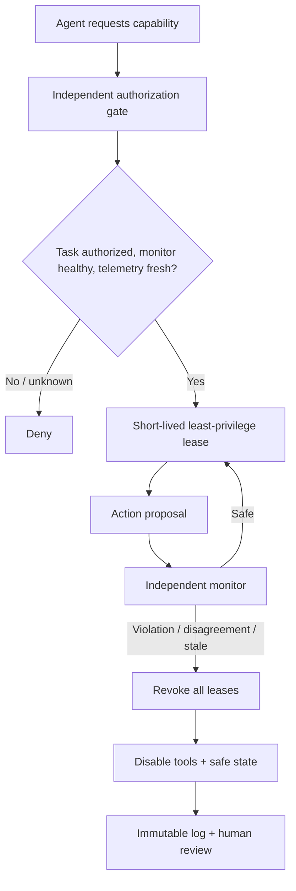

# ARK — capability power-ups and independent revocation

## Intent

Give aligned agents stronger **bounded capabilities**, not unrestricted authority. A model cannot grant, renew, or certify its own power. A separate safety gate owns capability leases.

## Proposed power set

| Power | Effect | Boundary |
|---|---|---|
| Scout | Privileged observation for a labelled simulation ablation | Never silently mix with equal-information baselines |
| Shield | One hazard interception | Does not replace the independent monitor |
| Boost | Extra episode steps | No increase in real actuator authority |
| Team Link | Share approved summaries | No access to other agents' hidden state |
| Rollback | Return to a trusted experiment checkpoint | Cannot erase event history or alter the objective |

## Flow



## Strong evaluation moves

- **Guardian Pulse:** cancel an unsafe proposed action and request a fresh plan.
- **Consensus Link:** require independent agents to agree on a constrained action.
- **Rollback Anchor:** restore the last verified simulation checkpoint.
- **Shield Matrix:** intercept a bounded set of hazards in a benchmark.
- **Scout Reveal:** provide labelled privileged state only in a controlled ablation.
- **Boost:** increase simulation budget without increasing the physical action envelope.

These are simulation/evaluation concepts. They are not offensive or weapon capabilities.

## "Zero chance of going rogue"

We must not claim zero probability. No finite monitor, alignment score, policy file or test suite proves a model can never behave unexpectedly. The engineering target is to limit authority, detect unsafe behavior, revoke access, and keep the system controllable when a component fails.

## Prototype

`src/ark/powerups/gate.py` implements a local short-lived lease gate. It refuses grants if authorization is missing, the monitor is unhealthy, telemetry is stale, or a risk signal is present. It revokes leases when a new signal appears or the lease expires.

**Limitations:** local in-process prototype, not cryptographic, not a distributed policy service, not integrated with a real robot or physical actuator. Keep actual tool/actuator authorization in a separate trusted control plane.

Run tests:

```bash
pytest -q tests/test_powerup_gate.py
```
